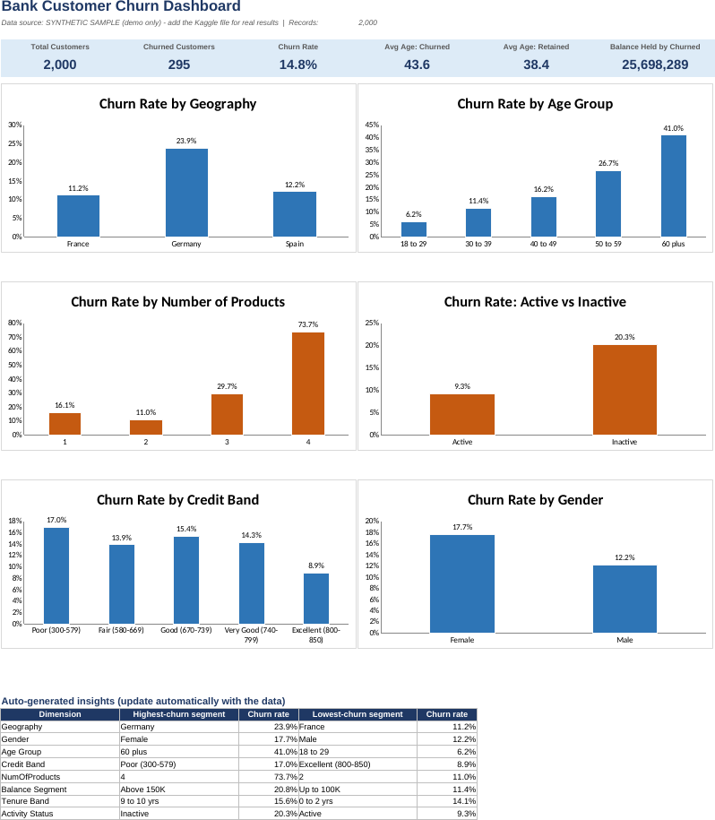

# Bank Customer Churn Analysis (Excel)

A formula-driven Excel dashboard that shows **which bank customers are leaving and why**, built to
answer a retention question a bank's business team would actually ask.



> The preview above uses the **synthetic demo sample**. Run the project on the real Kaggle file
> (steps below) and replace this image with your own screenshot.

## Business problem
Acquiring a new customer costs far more than keeping one. Which customer segments churn the most,
and where should the retention team focus first?

## What is inside
| Sheet | Purpose |
|-------|---------|
| Dashboard | 6 KPI cards, 6 churn-rate charts, auto-generated "highest / lowest churn segment" table |
| Analysis | One table per dimension (geography, gender, age, credit band, products, balance, tenure, activity) + Geography x Gender cross-tab |
| Data | Raw 14 columns + 5 helper formula columns (age group, credit band, etc.) |
| README | Definitions and assumptions |

Everything is an Excel formula (COUNTIFS, SUMIFS, AVERAGEIFS, INDEX/MATCH), so the workbook recalculates
when the data changes. No macros, no add-ins.

## Quick start (3 commands)
```bash
git clone https://github.com/<your-username>/bank-churn-excel-analysis.git
cd bank-churn-excel-analysis
pip install -r requirements.txt
python src/build_workbook.py        # builds excel/Bank_Churn_Analysis.xlsx
```
Open `excel/Bank_Churn_Analysis.xlsx`. **Prefer not to use Python?** Just open the ready-made workbook in `excel/`.

### Use the real data
1. Download `Churn_Modelling.csv` (see [data/README.md](data/README.md)) into `data/`.
2. Run `python src/build_workbook.py` again. It automatically picks the real file over the sample.

## Key findings (fill in from your run on the real data)
The Dashboard's last table lists the highest- and lowest-churn segment for each dimension automatically.
Copy the top results here, for example:

| Dimension | Highest-churn segment | Churn rate |
|-----------|----------------------|-----------|
| Geography | _fill in_ | _fill in_ |
| Age group | _fill in_ | _fill in_ |
| Number of products | _fill in_ | _fill in_ |
| Activity status | _fill in_ | _fill in_ |

## Recommendations (adapt to your findings)
1. Target the highest-churn age and geography segments with proactive retention offers.
2. Re-engage inactive members early (inactive status is a strong warning sign).
3. Review product bundling: check whether customers with unusual product counts churn more, and why.
4. Prioritise customers with high balances, since each churner removes more deposits.

## Assumptions and limits
- Churn = `Exited = 1`. Churn rate = churned / customers.
- Band thresholds (age, credit, balance, tenure) are my choices, listed on the README sheet. Change the helper formulas to test others.
- The dataset is a snapshot with no dates, so this shows association, not cause.
- Dataset currency is not stated, so balances have no currency symbol.

## Skills shown
Excel (COUNTIFS/SUMIFS/AVERAGEIFS, INDEX/MATCH, conditional formatting, charts, dashboard design),
Python (pandas, openpyxl), data validation, business storytelling.

## Project structure
```
bank-churn-excel-analysis/
├── README.md
├── requirements.txt
├── LICENSE
├── .gitignore
├── data/
│   ├── README.md                 # where to get the real data
│   └── sample/sample_churn_data.csv   # synthetic demo data
├── src/
│   ├── make_sample_data.py       # creates the synthetic sample
│   └── build_workbook.py         # builds the Excel workbook
├── excel/Bank_Churn_Analysis.xlsx
└── outputs/dashboard_preview.png
```

## Author
Vignesh M | Data Analytics | Chennai
